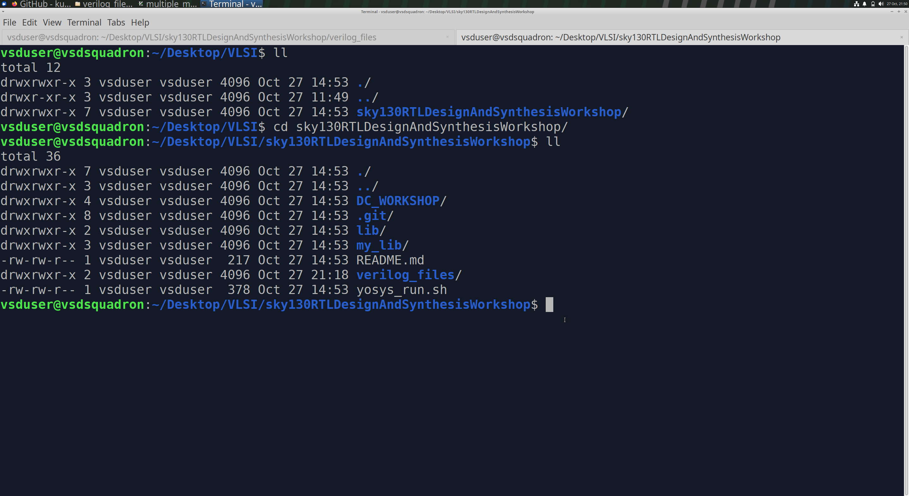
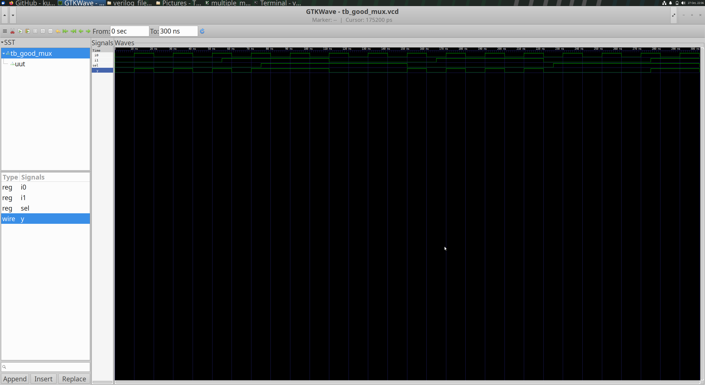
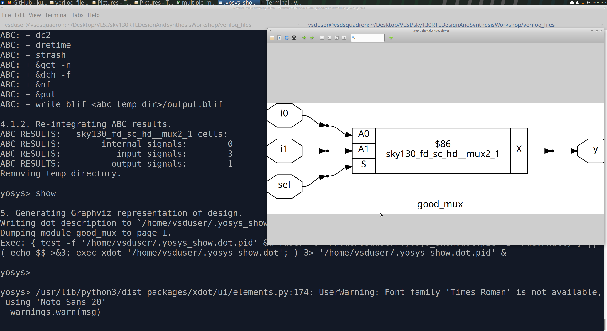

# Day 1: Introduction to Verilog RTL Design and Synthesis

## Objective

Understand the fundamentals of Verilog RTL design, testbenches, simulation using Icarus Verilog, waveform analysis using GTKWave, and logic synthesis using Yosys with the SKY130 standard-cell library.

## Tools Used

- **Verilog HDL:** Hardware description language used to describe digital circuits.
- **Icarus Verilog (`iverilog`):** Compiles Verilog design and testbench files for simulation.
- **GTKWave:** Visualizes simulation waveforms stored in VCD files.
- **Yosys:** Synthesizes RTL into a logic or gate-level netlist.
- **SKY130 standard-cell library:** Provides standard-cell definitions and characteristics used for technology mapping.

---

## 1. Introduction to Verilog RTL Design

### What is RTL Design?

Register Transfer Level (RTL) design describes the behavior and data flow of a digital circuit using a hardware description language such as Verilog.

The design is developed according to the required functional specifications.

### What is a Testbench?

A testbench is a verification environment that applies input stimuli to the design under test (DUT) and observes its outputs to check whether the design behaves as expected.

### What is a Simulator?

A simulator evaluates the behavior of a Verilog design over simulation time. It processes scheduled events and reevaluates affected logic when relevant signals or events change.

In this workshop, Icarus Verilog is used for simulation.

### Simulation Flow

1. Provide the RTL design and testbench to Icarus Verilog.
2. Compile the design and testbench to generate a simulation executable.
3. Run the executable to apply the testbench stimuli.
4. Generate a Value Change Dump (VCD) file using the testbench's waveform-dump commands.
5. Open the VCD file in GTKWave to inspect signal transitions and verify functionality.

**Flow:** RTL design + Testbench → Icarus Verilog → Simulation executable → VCD waveform → GTKWave

---

## 2. Lab 1: Repository Setup and RTL Simulation

### Clone the Workshop Repository

```bash
git clone https://github.com/kunalg123/sky130RTLDesignAndSynthesisWorkshop.git
cd sky130RTLDesignAndSynthesisWorkshop
ls -la
```

**Screenshot 1: Repository Directory Contents**



*Shows the contents of the cloned workshop repository.*

### Navigate to the Verilog Files

```bash
cd verilog_files
ls
```

The `verilog_files` directory contains the RTL design files and their corresponding testbenches.

### Simulate the 2:1 Multiplexer

Design file: `good_mux.v`

Testbench file: `tb_good_mux.v`

Compile the design and testbench:

```bash
iverilog good_mux.v tb_good_mux.v
```

A successful compilation generates the default executable `a.out`.

Execute the simulation:

```bash
./a.out
```

The testbench generates `tb_good_mux.vcd` if its waveform-dump commands are enabled.

Open the waveform:

```bash
gtkwave tb_good_mux.vcd
```

### Waveform Observation

The 2:1 multiplexer selects one of two inputs based on the select signal.

- When `sel = 0`, output `y` follows input `i0`.
- When `sel = 1`, output `y` follows input `i1`.

**Screenshot 2: `good_mux` Simulation Waveform**



*The waveform is used to observe the input and output transitions and verify the multiplexer behavior.*

---

## 3. Introduction to Yosys and Logic Synthesis

### What is a Synthesizer?

A synthesizer converts a synthesizable RTL description into a logic representation and can map the logic to cells from a target standard-cell library.

In this workshop, Yosys is used for RTL synthesis.

### What is Logic Synthesis?

Logic synthesis translates the behavioral or RTL description into a logic-level implementation.

The process includes:

1. Reading and elaborating the RTL.
2. Performing logic optimization.
3. Mapping logic to available standard cells.
4. Generating a gate-level netlist.

### What is a `.lib` File?

A Liberty (`.lib`) file describes standard cells and their implementation characteristics, including timing, area, power, and pin information.

A library may contain different drive strengths and cell variants suitable for different implementation requirements.

### Process Corners: TT, FF and SS

- **TT (Typical-Typical):** Typical NMOS and PMOS process characteristics.
- **FF (Fast-Fast):** Both NMOS and PMOS devices are at a fast process corner.
- **SS (Slow-Slow):** Both NMOS and PMOS devices are at a slow process corner.

Process corners are considered alongside voltage and temperature conditions during timing analysis.

- **Setup timing:** Slow cell and path delays can make setup timing harder to satisfy.
- **Hold timing:** Fast cell and path delays can make hold timing harder to satisfy.

Actual setup and hold results depend on the complete timing paths, clock relationships, and operating conditions.

### What are Synthesis Constraints?

Constraints guide implementation and optimization to meet design requirements. Timing constraints, for example, specify clocks and input/output timing assumptions. The selected library and cell choices also influence area, power, and delay.

---

## 4. Lab 2: Synthesis of the 2:1 Multiplexer Using Yosys

### Start Yosys

```bash
yosys
```

Run the following commands at the Yosys prompt.

### Step 1: Read the SKY130 Standard-Cell Library

```tcl
read_liberty -lib ../lib/sky130_fd_sc_hd__tt_025C_1v80.lib
```

This loads the standard-cell definitions for use during synthesis and technology mapping.

### Step 2: Read the RTL Design

```tcl
read_verilog good_mux.v
```

### Step 3: Synthesize the Design

```tcl
synth -top good_mux
```

This synthesizes the module named `good_mux`.

### Step 4: Map Logic to Standard Cells

```tcl
abc -liberty ../lib/sky130_fd_sc_hd__tt_025C_1v80.lib
```

ABC performs logic optimization and technology mapping using the specified library.

### Step 5: View the Synthesized Logic

```tcl
show
```

This displays the synthesized logic graph.

**Screenshot 3: Synthesized `good_mux` Logic**



*Shows the logic representation produced by the synthesis flow.*

### Step 6: Generate the Netlist

```tcl
write_verilog -noattr good_mux_netlist.v
```

The command writes the synthesized design to a Verilog netlist file.

To inspect it in GVim, if installed:

```tcl
!gvim good_mux_netlist.v
```

Alternatively, exit Yosys and inspect it in the terminal:

```bash
cat good_mux_netlist.v
```

---

## 5. Verification of the Synthesized Netlist

The synthesized netlist should be checked against the original RTL behavior.

### Verification Procedure

1. Simulate the original RTL with `tb_good_mux.v`.
2. Simulate the synthesized netlist with the same testbench.
3. Compare the resulting waveforms and output behavior for the same input stimuli.

For a SKY130 technology-mapped netlist, the simulation may also require the appropriate SKY130 Verilog standard-cell models.

The same testbench ensures that both implementations receive the same stimuli. Matching waveforms under the tested conditions provide evidence that the synthesized implementation preserves the expected functionality.

---

## 6. Key Learnings

- Understood the role of RTL design, testbenches, and simulation.
- Learned the Icarus Verilog compilation and simulation flow.
- Generated and inspected VCD waveforms using GTKWave.
- Understood the purpose of Yosys in RTL synthesis.
- Learned how a Liberty library is used during technology mapping.
- Synthesized a 2:1 multiplexer and generated a Verilog netlist.
- Studied the role of process corners and timing requirements in standard-cell implementation.
- Learned the importance of verifying synthesized logic against the original RTL.

## References

- [VSD RTL Design and Synthesis Workshop](https://github.com/kunalg123/sky130RTLDesignAndSynthesisWorkshop)
- [Icarus Verilog](https://steveicarus.github.io/iverilog/)
- [Yosys Documentation](https://yosyshq.readthedocs.io/)
- [GTKWave](https://gtkwave.sourceforge.net/)

