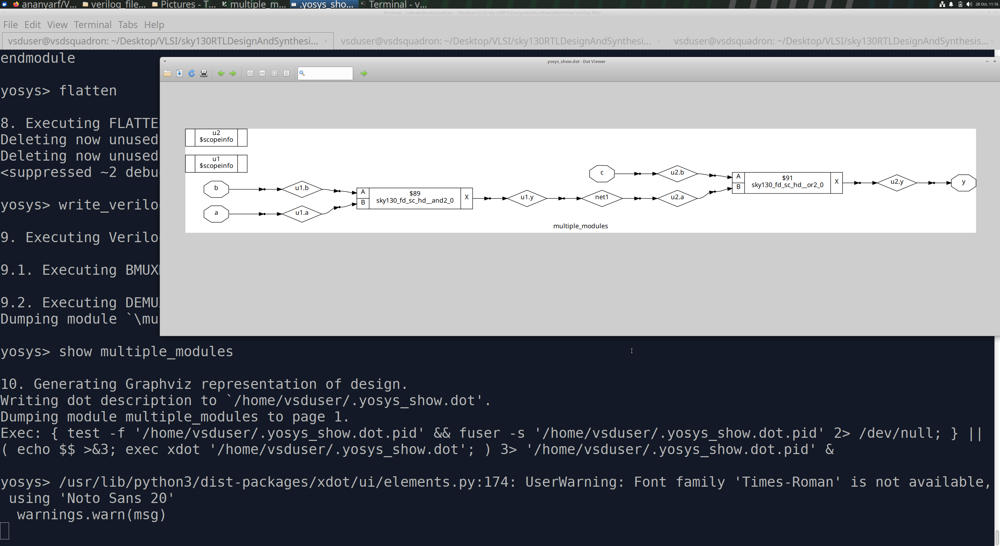
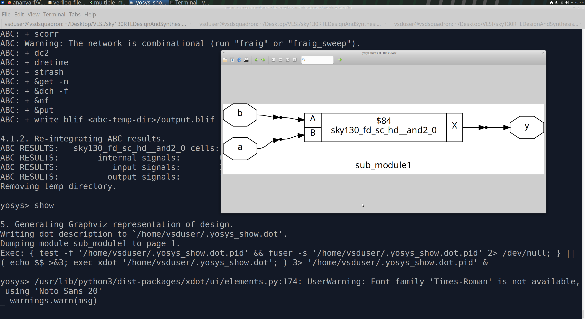
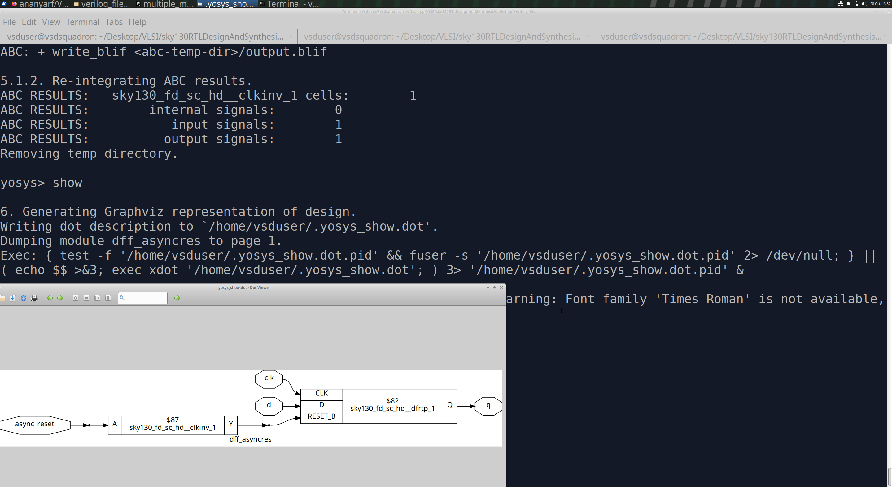
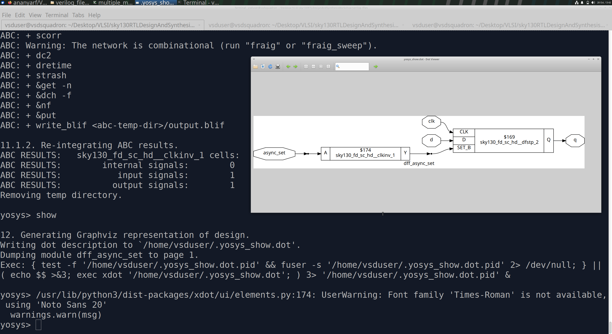
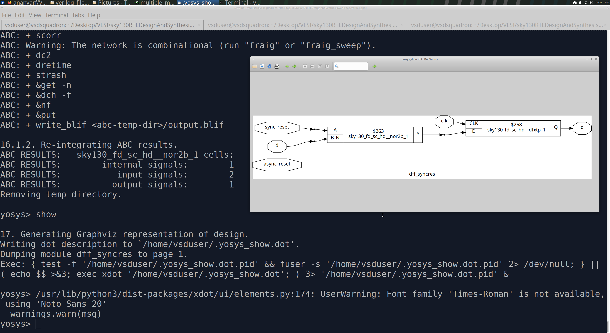
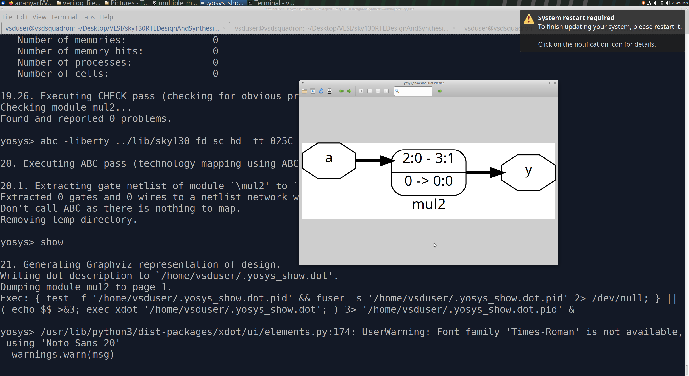
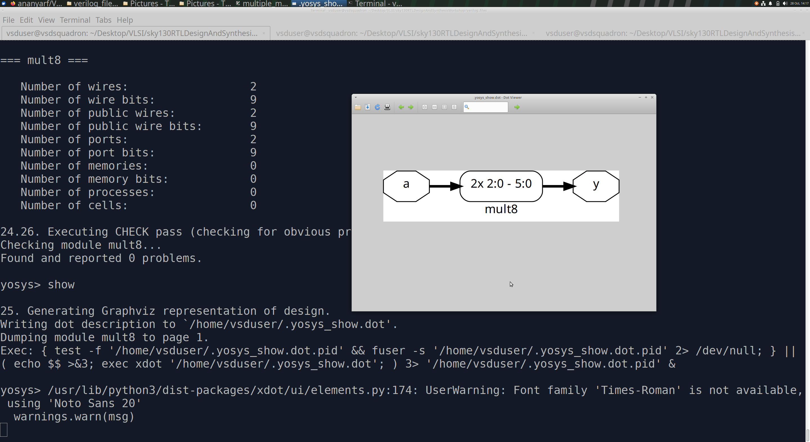

# Day 2: Timing Libraries, Hierarchical Synthesis and Flop Optimization

## Objective

Explore standard-cell timing libraries, hierarchical and flat synthesis, flip-flop coding styles, and logic optimizations using Yosys.

## 1. Timing Libraries

A Liberty (`.lib`) file describes standard cells and their characteristics, including area, timing arcs, setup and hold times, power, and pin information. Libraries may provide different cell variants and process corners such as TT, FF, and SS.

## 2. Hierarchical vs. Flat Synthesis

Hierarchical synthesis preserves module boundaries, while flat synthesis combines the logic into a flattened design, enabling optimization across module boundaries.

- **Hierarchical synthesis:** Inspected a design containing OR and AND submodules.
- **Flat synthesis:** Used `flatten` in Yosys and inspected the resulting logic.
- **Submodule synthesis:** Synthesized an individual module to examine its logic independently.

| Experiment | Screenshot |
|---|---|
| Hierarchical synthesis |  |
| Flat synthesis |  |
| Submodule synthesis |  |

**Importance:** Submodule synthesis supports modular verification, reusable IP development, and independent analysis of individual design blocks.

## 3. Flip-Flop Coding Styles

Flip-flops store state and synchronize data with clock events. Registering signals at suitable boundaries can prevent combinational glitches from propagating into downstream sequential logic.

- **Reset:** Forces the stored output to 0.
- **Preset/Set:** Forces the stored output to 1.
- **Synchronous reset:** Takes effect at the active clock edge.
- **Asynchronous reset:** Takes effect independently of the clock.

When reset and preset are both present, their priority and simultaneous assertion behavior depend on the selected cell. Reset deassertion must satisfy the relevant timing requirements.

### Synthesis Experiments

- **Asynchronous reset:** An inverter may be required to match the RTL reset polarity to the available cell's active-low reset pin.
- **Asynchronous set:** Examined the synthesized settable flip-flop implementation.
- **Synchronous reset:** Inspected the logic used to implement the reset behavior.

| Experiment | Screenshot |
|---|---|
| Asynchronous reset |  |
| Asynchronous set |  |
| Synchronous reset |  |

## 4. Logic Optimization

### Multiplication by Two

For a 3-bit unsigned input `a` and 4-bit output `y`:

`y = a * 2`

This is equivalent to `y = {a, 1'b0}`. Synthesis can implement the operation using a shift and wiring instead of a general multiplier.

### Multiplication by Nine

For a 3-bit unsigned input and 6-bit output:

`y = a * 9 = {a, a}`

Since \(9 = 8 + 1\), the result can be implemented through bit concatenation rather than a general multiplier.

## Key Learnings

- Studied timing-library contents and standard-cell characteristics.
- Compared hierarchical and flat synthesis.
- Explored synchronous and asynchronous flip-flop controls.
- Observed synthesis mapping and polarity adaptation.
- Investigated constant-multiplication optimizations.

## Tools

Yosys · SKY130 standard-cell library · Verilog HDL
