# Day 3: Introduction to Logic Optimizations

## Objective

Understand combinational and sequential logic optimization techniques in Yosys, including constant propagation, Boolean simplification, sequential constant optimization, and removal of unused logic.

## 1. Combinational Logic Optimization

Combinational logic optimization simplifies digital logic while preserving its functionality.

- **Constant propagation:** Replaces signals with known constant values (`0` or `1`) and simplifies the logic driven by them.
- **Boolean logic optimization:** Applies Boolean algebra and logic transformations to reduce unnecessary gates and simplify expressions.

### Lab 1: `opt_check`

The design contains a multiplexer with one input tied to logic `0`. Simplifying the multiplexer results in an AND gate.

Commands used:

```tcl
read_liberty -lib ../lib/sky130_fd_sc_hd__tt_025C_1v80.lib
read_verilog opt_check.v
synth -top opt_check
opt_clean -purge
abc -liberty ../lib/sky130_fd_sc_hd__tt_025C_1v80.lib
show
```

The `opt_clean -purge` command removes unused wires and cells, including certain unused internal signals and objects.

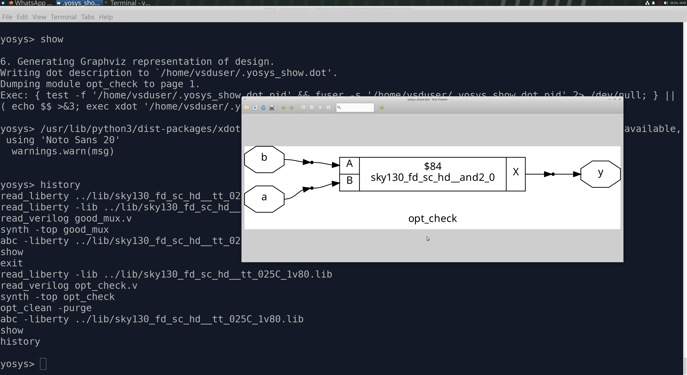

### Lab 2: `opt_check2`

A multiplexer with one input tied to logic `1` simplifies to an OR gate, depending on the select and input connections.

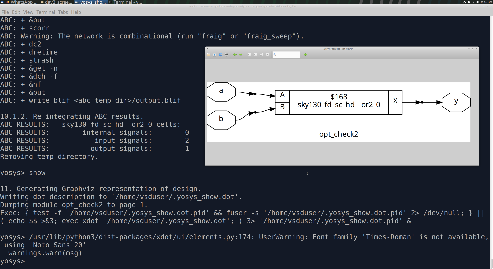

### Lab 3: `opt_check3`

A multiplexer with connections to ground is simplified using constant propagation and Boolean logic optimization, resulting in a three-input AND gate.

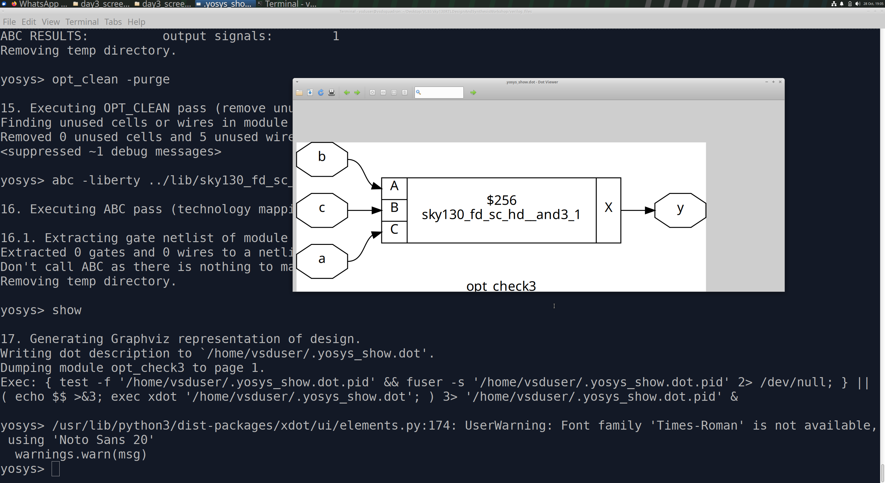

### Lab 4: `opt_check4`

The original logic was analyzed and simplified. Yosys produced an XNOR-equivalent implementation, confirming the Boolean simplification.

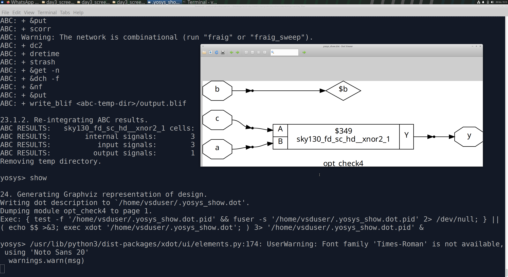

### Lab 5: `multiple_module`

The original Verilog file was inspected before synthesis. The design hierarchy was flattened and the optimization passes were applied. The resulting logic was simplified to a single cell.

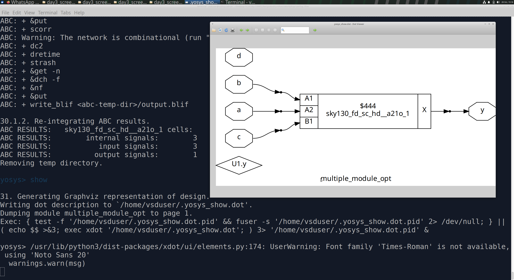

### Lab 6: `multiple_module_opt2`

A second multiple-module example was analyzed using the same flattening and optimization approach.

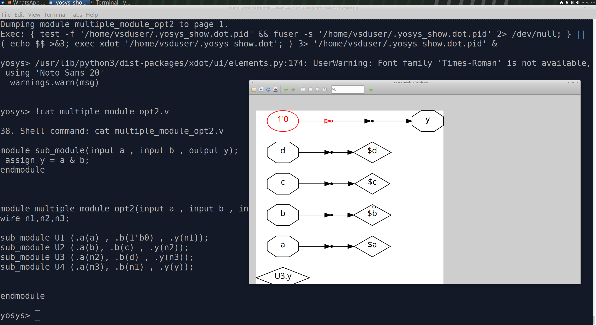

## 2. Sequential Logic Optimization

Sequential logic optimization simplifies circuits containing flip-flops and state elements while preserving their cycle-by-cycle behavior.

- **Constant propagation:** Uses known values on sequential inputs, resets, or states to simplify registers and their surrounding logic.
- **Retiming:** Moves registers across combinational logic to improve timing while preserving the required input-output behavior and latency constraints.
- **Sequential logic cloning:** Duplicates registers or sequential logic when beneficial for timing, fanout, or implementation.
- **State optimization:** Removes redundant states or simplifies state encoding when the resulting behavior remains equivalent.

The applicability of these techniques depends on the RTL, synthesis passes, constraints, and target library.

### 2.1 Constant Flip-Flop Examples

#### `dff_const1` and `dff_const2`

Both examples were simulated and synthesized to study constant propagation in sequential logic.

- In `dff_const1`, the asynchronous reset and constant data value produce a behavior that must be considered with the reset polarity and timing.
- In `dff_const2`, the reset and data values make the output constant under the specified conditions, allowing Yosys to remove unnecessary sequential hardware.

**Waveform comparison**

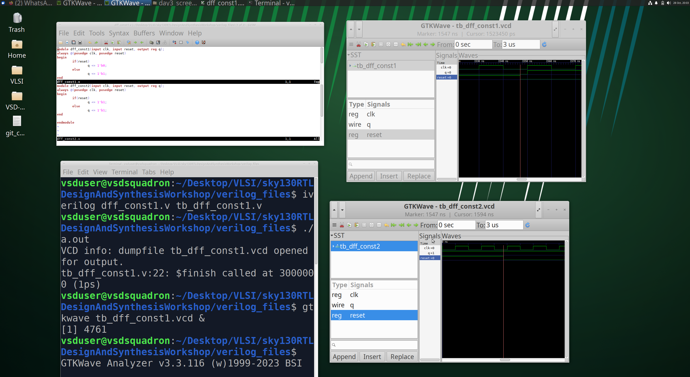

**Synthesized logic diagrams**

The diagrams compare the resulting implementations. One retains sequential logic, while the constant-output case can reduce to a constant connection.

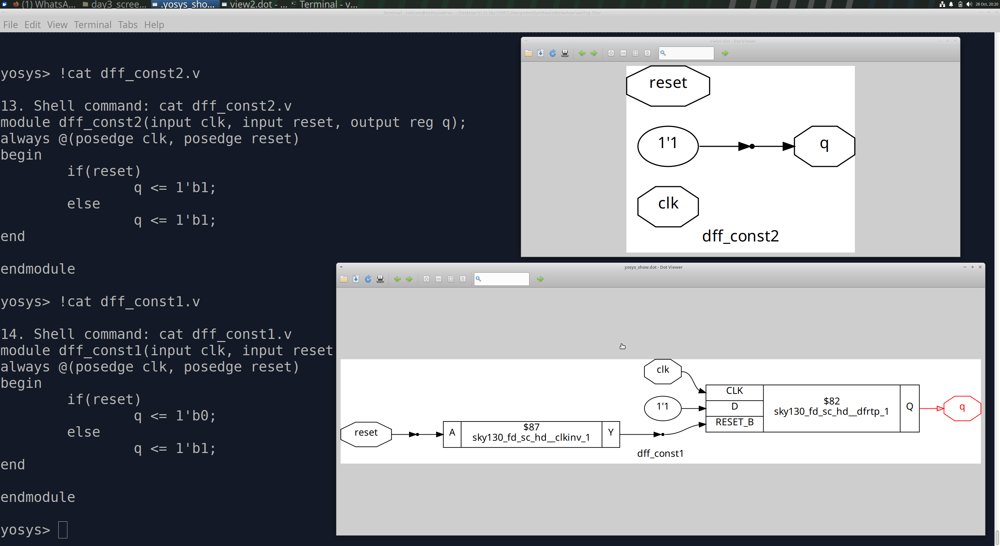

### 2.2 `dff_const3`: Sequential Dependency

This example contains two flip-flops, with one flip-flop's output feeding the set input of another.

When reset is asserted, the first output changes according to its reset behavior. Because the second flip-flop samples its input at a clock edge, it responds to the preceding value according to the clocked behavior and propagation timing.

The sequential dependency means that the registers cannot necessarily be replaced by constants.

**GTKWave observation**

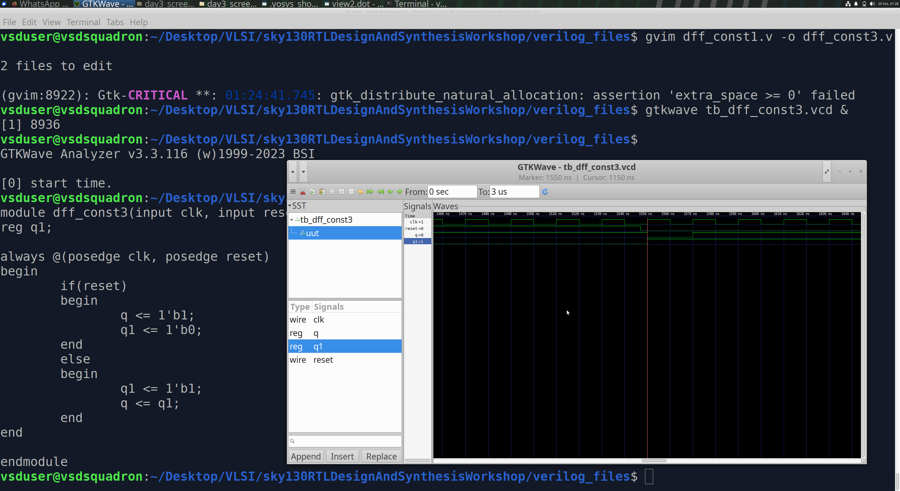

**Synthesized logic diagram**

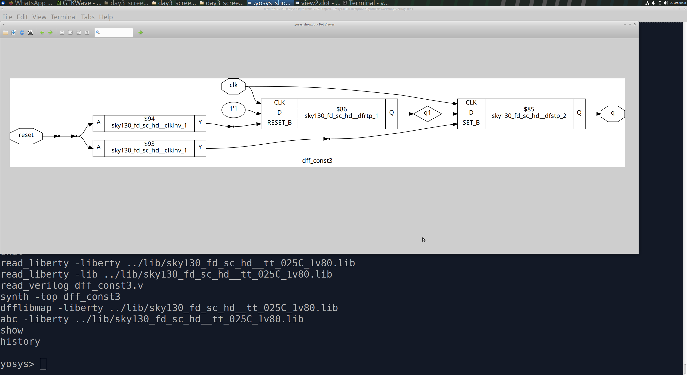

Both flip-flops are preserved in this synthesis result.

### 2.3 `dff_const4`: Constant Sequential Optimization

In this example, the reset and set conditions drive both flip-flops toward constant values. Under the conditions represented in the RTL, the sequential elements can be optimized away, leaving constant connections.

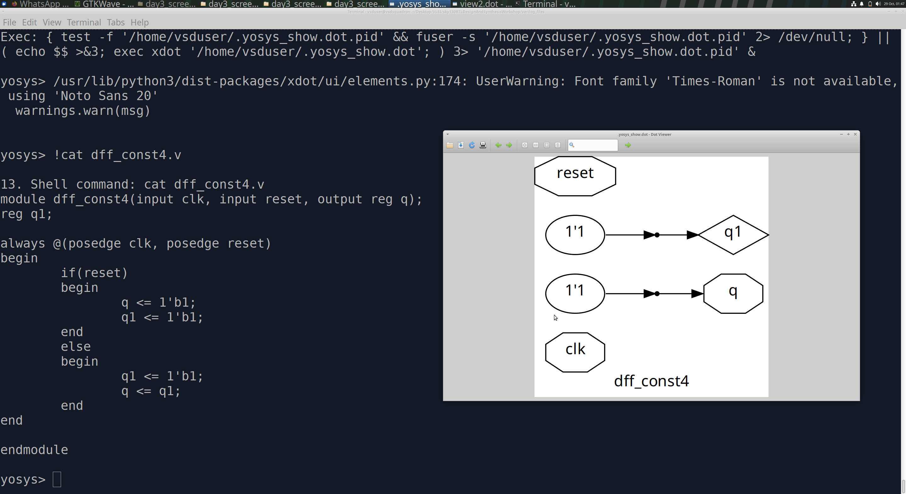

### 2.4 `dff_const5`: Registers Preserved

In this example, both reset conditions are set to `0`. The resulting behavior differs from the previous case, so the registers are preserved in the observed synthesis result.

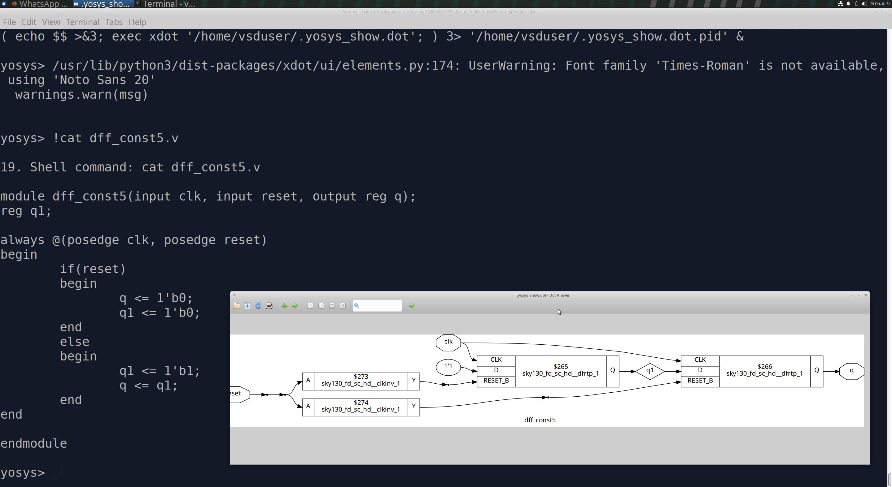

These experiments demonstrate that a register connected to a constant signal is not automatically removable. Its reset, set, data, control conditions, and sequential dependencies must be considered together.

## 3. Unused-Output Optimization

Synthesis tools remove logic that does not affect observable outputs or other required behavior. This reduces unnecessary hardware.

### 3.1 `counter_opt`

The design contains a three-bit counter, but the output `q` uses only `count[0]`.

The upper two counter bits do not affect the observable output and can be removed. The least significant bit toggles, allowing the optimized implementation to use a flip-flop and inverter.

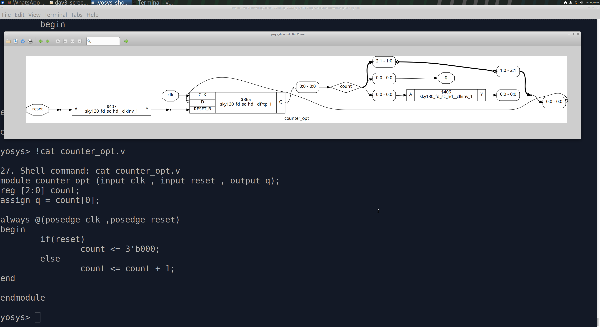

### 3.2 `counter_opt2`

In this example, the output is changed to a comparison involving the full counter value:

`q = (count == 3'b100)`

All three counter bits contribute to the comparison, so the upper bits are now relevant to the observable output. The counter registers therefore cannot be removed simply as unused bits.

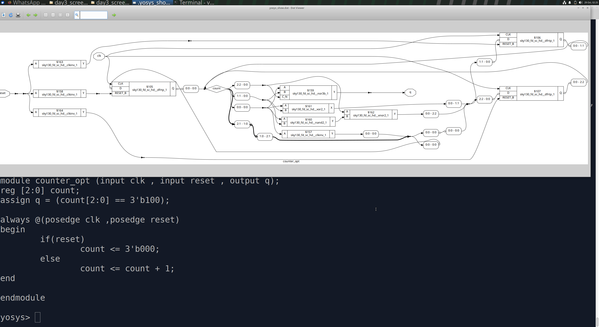

## Key Learnings

- Applied constant propagation and Boolean simplification to combinational logic.
- Observed the effect of `opt_clean -purge` in the Yosys synthesis flow.
- Studied constant propagation and preservation of sequential elements.
- Understood how reset/set behavior and sequential dependencies affect optimization.
- Observed removal of unused counter bits when they do not affect outputs.
- Learned that synthesis optimizations preserve required observable behavior.

## Conclusion

This lab demonstrated how Yosys simplifies combinational logic, evaluates sequential behavior, and removes unnecessary hardware. Understanding these optimizations helps in writing efficient RTL and interpreting synthesized implementations.

## Tools Used

- Verilog HDL
- Yosys
- Icarus Verilog
- GTKWave
- SKY130 standard-cell library
