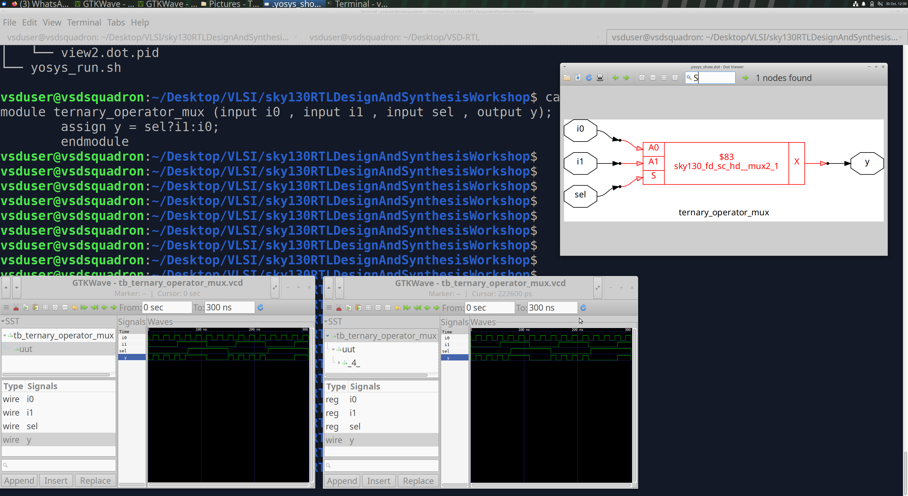
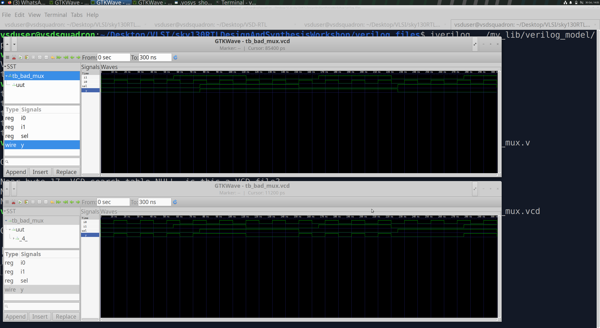
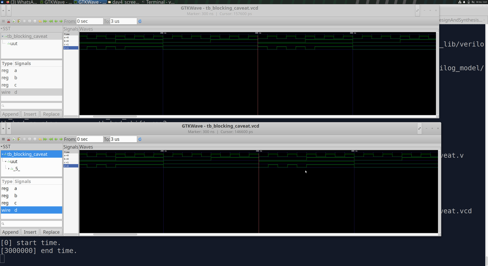

# Day 4 – Gate-Level Simulation (GLS), Blocking vs Non-Blocking Assignments and Synthesis-Simulation Mismatch

## 1. Introduction to Gate-Level Simulation (GLS)

RTL simulation verifies the design functionality against the given specification using a testbench. However, after synthesis, the RTL is converted into a gate-level netlist consisting of standard cells.

**Gate-Level Simulation (GLS)** is performed by simulating this synthesized netlist using the same testbench that was used for RTL simulation.

The main objective is to verify that the functionality of the design is preserved after synthesis.

### 1.1 RTL Simulation vs Gate-Level Simulation

| RTL Simulation | Gate-Level Simulation |
|---|---|
| Uses RTL Verilog code | Uses synthesized gate-level netlist |
| Describes design using behavioral or RTL constructs | Represents the design using standard-cell instances |
| Checks the intended RTL functionality | Checks functionality after synthesis |
| Does not require standard-cell models | Requires standard-cell Verilog models |

### 1.2 GLS Flow

The general GLS flow is:

1. Write the RTL design and testbench.
2. Simulate the RTL using Icarus Verilog.
3. Synthesize the RTL using Yosys.
4. Generate the gate-level netlist.
5. Simulate the netlist using the standard-cell Verilog models and the same testbench.
6. Compare the RTL and gate-level simulation waveforms.

**Important:** Timing-aware GLS uses Standard Delay Format (SDF) annotation to include cell and interconnect delays. Timing-aware GLS is outside the scope of this workshop. The simulations performed here are functional GLS, not SDF-based timing simulations.

---

## 2. Functional GLS – Ternary Operator MUX

The first experiment demonstrates the functional GLS flow using a 2:1 multiplexer implemented with the Verilog ternary operator.

### 2.1 RTL Code

The ternary operator selects one of the two inputs based on the select signal.

```verilog
assign y = sel ? i1 : i0;
```

- When `sel = 1`, output `y` follows `i1`.
- When `sel = 0`, output `y` follows `i0`.

### 2.2 RTL Simulation

Compile and simulate the RTL design using Icarus Verilog:

```bash
iverilog ternary_operator_mux.v tb_ternary_operator_mux.v
./a.out
gtkwave tb_ternary_operator_mux.vcd
```

The generated VCD file can be opened in GTKWave to observe the input and output waveforms.

### 2.3 Synthesis Using Yosys

The RTL design is synthesized using the SKY130 standard-cell library.

```tcl
read_liberty -lib ../lib/sky130_fd_sc_hd__tt_025C_1v80.lib
read_verilog ternary_operator_mux.v
synth -top ternary_operator_mux
dfflibmap -liberty ../lib/sky130_fd_sc_hd__tt_025C_1v80.lib
abc -liberty ../lib/sky130_fd_sc_hd__tt_025C_1v80.lib
write_verilog -noattr ternary_operator_mux_net.v
```

The synthesized gate-level netlist is generated as `ternary_operator_mux_net.v`.

### 2.4 Gate-Level Simulation

To simulate the synthesized netlist, compile it along with the SKY130 standard-cell Verilog models and the same testbench.

```bash
iverilog ../my_lib/verilog_model/primitives.v ../my_lib/verilog_model/sky130_fd_sc_hd.v ternary_operator_mux_net.v tb_ternary_operator_mux.v
./a.out
gtkwave tb_ternary_operator_mux.vcd
```

### 2.5 Simulation Results

**Screenshot 1 – Ternary MUX: RTL Simulation, Gate-Level Simulation and Synthesis**



**Observation:**

- The upper waveform shows the RTL simulation.
- The middle waveform shows the gate-level simulation.
- The Verilog code implements a 2:1 MUX using the ternary operator.
- The Yosys schematic shows the synthesized MUX logic.
- Both RTL and gate-level simulations show the expected MUX functionality.

**Conclusion:** The synthesized netlist preserves the intended functionality of the RTL design.

---

## 3. Synthesis-Simulation Mismatch Due to Missing Sensitivity List

A synthesis-simulation mismatch occurs when the behavior observed during RTL simulation differs from the behavior of the synthesized hardware.

One common reason is an incomplete sensitivity list in a combinational `always` block.

### 3.1 Understanding the Sensitivity List

An event-driven simulator executes an `always` block whenever a signal included in its sensitivity list changes.

Consider the following code:

```verilog
always @(sel)
begin
    if (sel)
        d = b;
    else
        d = a;
end
```

Here, only `sel` is included in the sensitivity list.

**What happens?**

- When `sel` changes, the `always` block executes.
- When `a` or `b` changes without a change in `sel`, the block does not execute.
- Therefore, the RTL simulation may retain an old output value even though the input has changed.

However, the synthesized hardware represents a multiplexer whose output responds to changes in all its inputs.

### 3.2 Correct Coding Style

For combinational logic, use `always @(*)` so that all signals read inside the block are included in the inferred sensitivity list.

```verilog
always @(*)
begin
    if (sel)
        d = b;
    else
        d = a;
end
```

### 3.3 Simulation Results

**Screenshot 2 – Missing Sensitivity List: RTL vs Gate-Level Simulation**



**Observation:**

- The upper waveform shows the RTL simulation.
- The lower waveform shows the gate-level simulation.
- In RTL simulation, changes in `a` and `b` alone do not trigger the `always @(sel)` block.
- The synthesized MUX responds to changes in its input signals as expected.

**Conclusion:** An incomplete sensitivity list can cause RTL simulation to behave differently from the synthesized hardware. Using `always @(*)` is the recommended coding style for combinational logic.

---

## 4. Blocking and Non-Blocking Assignments

Verilog provides two types of procedural assignments:

| Blocking Assignment (`=`) | Non-Blocking Assignment (`<=`) |
|---|---|
| Executes immediately | Schedules the update for the end of the current simulation time step |
| Statements execute in procedural order | Updates are applied after the current procedural evaluation |
| Commonly used for combinational logic | Recommended for sequential logic |

### 4.1 Blocking Assignment – Combinational Logic

Consider the following code:

```verilog
always @(*)
begin
    d = x & c;
    x = a | b;
end
```

Here:

- `a`, `b`, and `c` are inputs.
- `x` is an internal signal.
- `d` is the output.

Because blocking assignments execute immediately in procedural order, `d` is evaluated using the value of `x` available before the assignment `x = a | b` is executed.

Now consider the statements in the reverse order:

```verilog
always @(*)
begin
    x = a | b;
    d = x & c;
end
```

In this case, `x` is updated first, and `d` uses the newly assigned value of `x`.

This demonstrates how the order of blocking assignments can affect RTL simulation behavior.

In synthesis, the intended combinational relationship is:

```verilog
d = (a | b) & c;
```

The synthesized combinational circuit is determined by the logic relationships, rather than the procedural execution order used by the simulator.

**Screenshot 3 – Blocking Assignment Caveat: RTL vs Gate-Level Simulation**



**Observation:**

- The upper waveform shows the RTL simulation.
- The lower waveform shows the gate-level simulation.
- The RTL waveform demonstrates the effect of the blocking assignment order.
- The synthesized logic represents the combinational relationship inferred by synthesis.

**Conclusion:** Blocking assignments in combinational logic must be written carefully. The order of statements can affect simulation behavior and may lead to an RTL-synthesis mismatch.

### 4.2 Blocking Assignment – Sequential Logic

Consider a two-flip-flop shift-register example:

```verilog
always @(posedge clk)
begin
    q = q0;
    q0 = d;
end
```

With blocking assignments:

1. `q` gets the current value of `q0`.
2. `q0` is then updated with `d`.

If the order is reversed:

```verilog
always @(posedge clk)
begin
    q0 = d;
    q = q0;
end
```

Now `q0` is updated first, and `q` receives the newly assigned value of `q0`.

This changes the behavior because blocking assignments execute immediately. Depending on the coding, synthesis may also infer different hardware, including optimization of the intended two-stage storage into a single flip-flop.

### 4.3 Non-Blocking Assignment – Recommended Sequential Coding Style

The recommended way to describe the two-flip-flop shift register is:

```verilog
always @(posedge clk)
begin
    q  <= q0;
    q0 <= d;
end
```

With non-blocking assignments, both right-hand-side values are evaluated using the values present before the clock-triggered updates.

Therefore:

- `q` receives the previous value of `q0`.
- `q0` receives the value of `d`.
- Both updates occur at the end of the current simulation time step.
- The result is independent of the order of the two statements.

**Key takeaway:** Use blocking assignments (`=`) for combinational procedural logic and non-blocking assignments (`<=`) for sequential logic to avoid simulation mismatches and describe the intended hardware clearly.

---

## 5. Key Learnings

- Understood the purpose and flow of Gate-Level Simulation.
- Compared RTL simulation with functional gate-level simulation.
- Learned how to simulate a synthesized SKY130 gate-level netlist using standard-cell Verilog models.
- Understood how incomplete sensitivity lists can cause synthesis-simulation mismatches.
- Studied the effect of blocking assignment order on simulation behavior.
- Understood why non-blocking assignments are preferred for sequential logic.
- Learned that timing-aware GLS requires SDF annotation and was not covered in this workshop.

---

## 6. Tools Used

- **Icarus Verilog** – RTL and gate-level simulation.
- **Yosys** – RTL synthesis and gate-level netlist generation.
- **GTKWave** – Waveform visualization.
- **SKY130 HD Standard Cell Library** – Standard-cell library and Verilog simulation models.

