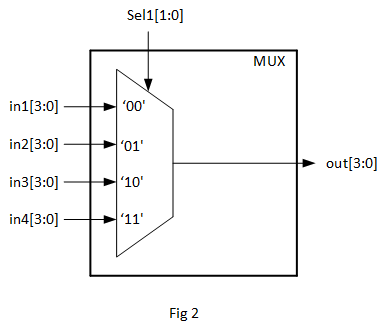
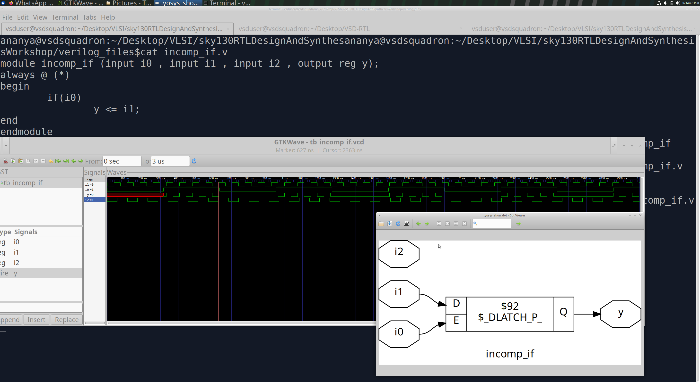
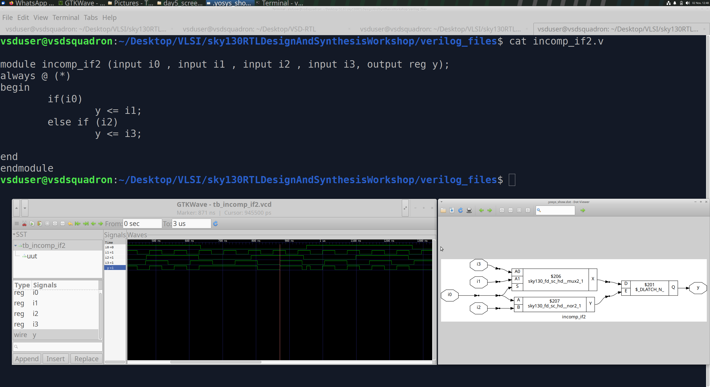
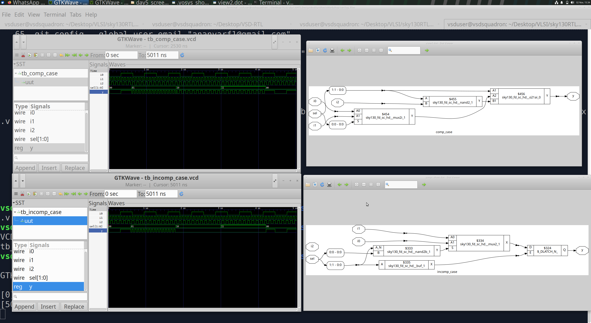
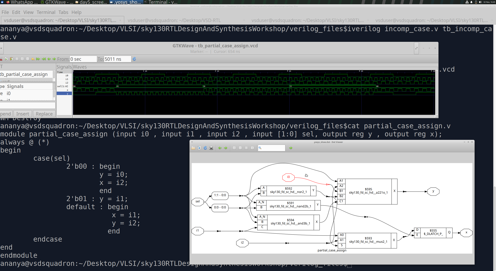
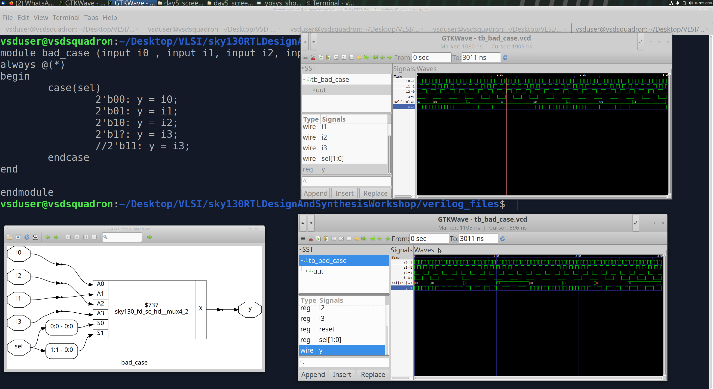
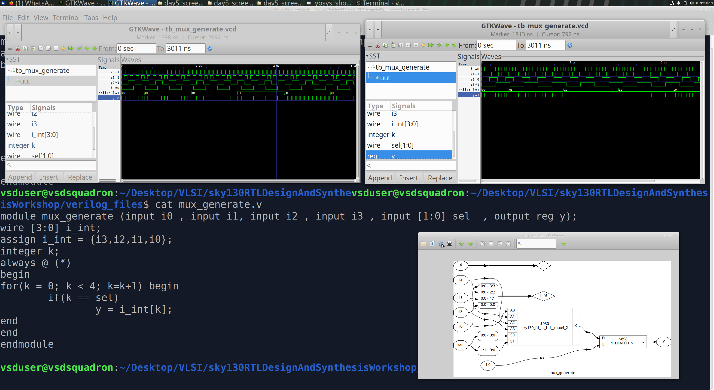
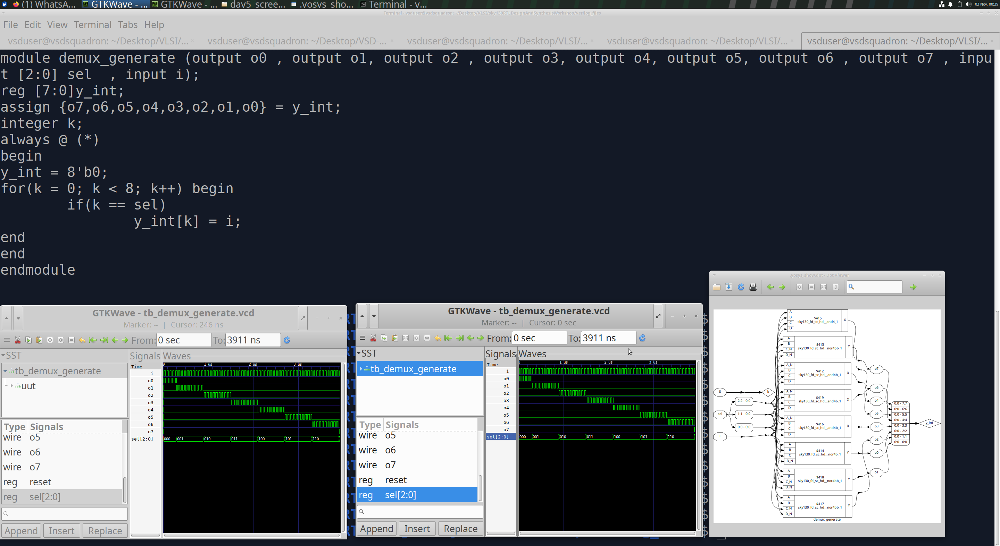
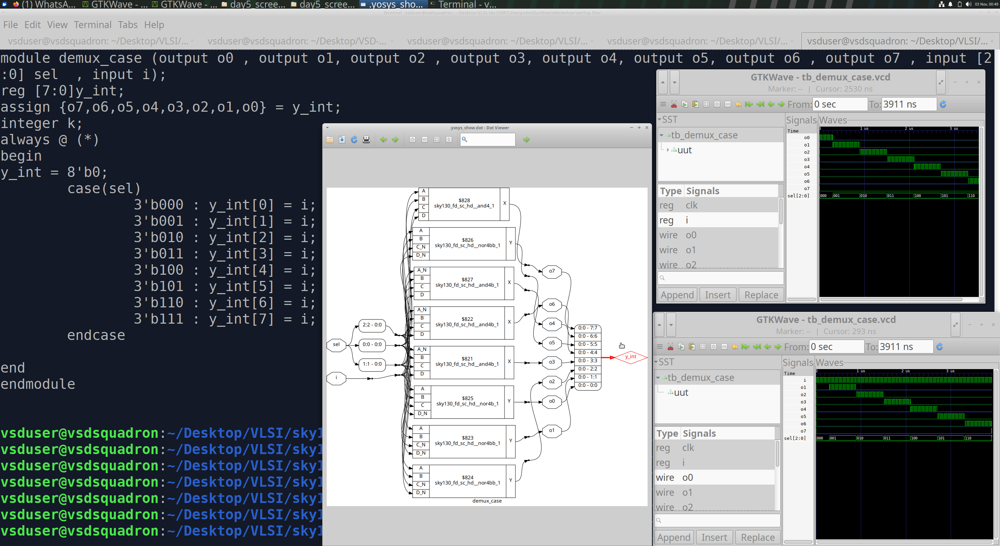
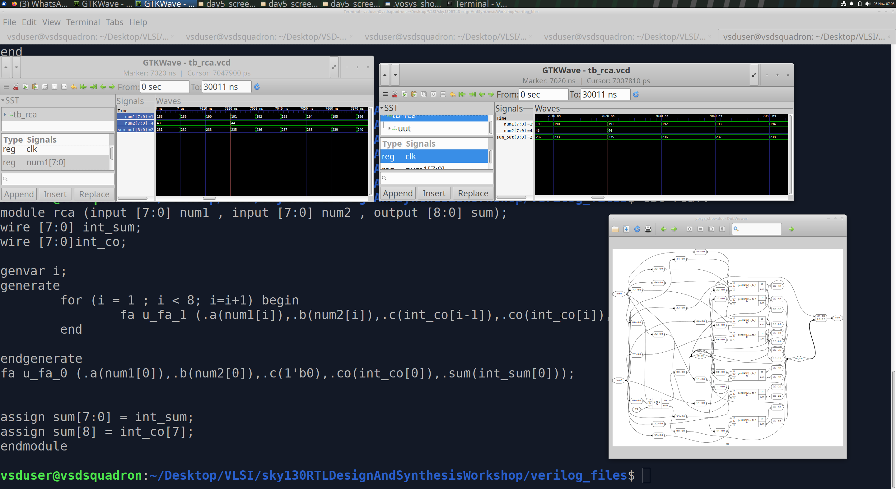

# Day 5 – Optimization in Synthesis

## 1. Introduction

Synthesis converts RTL code into hardware consisting of logic gates, multiplexers, flip-flops, and other standard cells. The way RTL is written directly affects the hardware inferred by synthesis.

In this session, I explored:

- `if-else` and `case` constructs
- MUX inference and priority logic
- Latch inference due to incomplete assignments
- Complete and incomplete `case` statements
- Overlapping case conditions
- Procedural `for` loops
- `generate for` loops
- MUX and DEMUX implementations
- Ripple Carry Adder (RCA) using generated hardware

---

## 2. If-Else Constructs and Priority Logic

An `if-else` construct is used to describe conditional behavior in RTL.

```verilog
always @(*)
begin
    if (cond1)
        y = a;
    else if (cond2)
        y = b;
    else
        y = c;
end
```

The conditions are evaluated in order. If `cond1` is true, the first assignment is executed and the remaining conditions are skipped. `cond2` is checked only when `cond1` is false.

This creates **priority logic**. In hardware, the selection can be implemented using nested or cascaded multiplexers.

### If-Else Hardware


The Yosys schematic shows the nested MUX structure corresponding to the priority of the conditions. The first condition has the highest priority, followed by the subsequent conditions.

---

## 3. Latch Inference – Incomplete Conditional Assignments

A latch is inferred when a variable is not assigned a value in every possible execution path of a combinational block.

Consider:

```verilog
always @(*)
begin
    if (cond1)
        y = a;
    else if (cond2)
        y = b;
end
```

Here, there is no assignment when both conditions are false.

### What happens in hardware?

The synthesis tool interprets the missing assignment as a requirement to retain the previous value of `y`.

Retaining a previous value requires storage. Since a combinational circuit cannot remember values, synthesis infers a **latch**.

- `cond1` is true → `y` follows `a`.
- `cond2` is true and `cond1` is false → `y` follows `b`.
- Both conditions are false → `y` retains its previous value.

The latch enable is effectively `cond1 | cond2`. It is transparent when either condition is true and holds its value when both conditions are false.

Latches are not always wrong, but they should be inferred only when storage is intentionally required. Accidental latch inference is generally considered a bad coding practice in combinational RTL.

---

## 4. Case Constructs

A `case` statement is another way to describe selection logic. It is commonly used to implement multiplexers and control logic.

### Syntax

```verilog
always @(*)
begin
    case (sel)
        2'b00: y = i0;
        2'b01: y = i1;
        2'b10: y = i2;
        2'b11: y = i3;
        default: y = 1'b0;
    endcase
end
```

Each case item selects a corresponding input based on `sel`.

Unlike an `if-else if` chain, a normal `case` statement does not establish priority between case items. The conditions should be mutually exclusive.

### Case Hardware



The synthesized schematic shows the MUX hardware corresponding to the case selection logic.

---

## 5. Case, Casez and Casex

Verilog provides different types of case statements for matching values.

| Construct | Matching behavior |
|---|---|
| `case` | Exact four-state matching |
| `casez` | Treats `z` and `?` bits as wildcards |
| `casex` | Treats `x`, `z`, and `?` bits as wildcards |

### Example using casez

```verilog
always @(*)
begin
    casez (sel)
        2'b00:  y = i0;
        2'b01:  y = i1;
        2'b10:  y = i2;
        2'b1?:  y = i3;
        default: y = 1'b0;
    endcase
end
```

In this example, `2'b1?` matches both `2'b10` and `2'b11`.

### Important points

- Regular `case` performs exact matching. `?` represents a `z` value and is not a general wildcard.
- `casez` treats `z` and `?` as wildcards.
- `casex` treats `x`, `z`, and `?` as wildcards.
- Overlapping wildcard patterns should be avoided.
- `casex` is generally discouraged in synthesizable RTL because it can hide unknown values and lead to simulation mismatches.

---

## 6. Lab 1 – Incomplete If Statement

```verilog
module incomp_if (
    input i0,
    input i1,
    output reg y
);

always @(*)
begin
    if (i0)
        y <= i1;
end

endmodule
```

This code assigns `y` only when `i0` is high. When `i0` is low, there is no assignment, so the output must retain its previous value.

To implement this behavior, synthesis infers a D latch.

### Incomplete If



In GTKWave, `y` follows `i1` while `i0` is high. Once `i0` becomes low, `y` holds its previous value until `i0` becomes high again. The Yosys schematic confirms that the inferred hardware is a D latch rather than a purely combinational MUX.

---

## 7. Lab 2 – Multiple Incomplete If Conditions

```verilog
module incomp_if2 (
    input i0,
    input i1,
    input i2,
    input i3,
    output reg y
);

always @(*)
begin
    if (i0)
        y <= i1;
    else if (i2)
        y <= i3;
end

endmodule
```

The first condition selects `i1`, while the second condition selects `i3` only when `i0` is false.

When both `i0` and `i2` are low, no assignment is made to `y`. Therefore, the output must retain its previous value, requiring a latch.

### Incomplete If-Else If



The waveform shows the output following the selected input when either condition is active. When both conditions are inactive, the output holds its previous value. In the Yosys schematic, we can see both the MUX logic used for selection and the latch used to preserve the output.

---

## 8. Lab 3 – Complete vs Incomplete Case Statements

A complete case statement assigns a value for every possible condition.

### Complete Case

```verilog
always @(*)
begin
    case (sel)
        2'b00: y = i0;
        2'b01: y = i1;
        default: y = i2;
    endcase
end
```

The `default` branch handles the remaining input combinations.

### Incomplete Case

```verilog
always @(*)
begin
    case (sel)
        2'b00: y = i0;
        2'b01: y = i1;
    endcase
end
```

For `sel = 2'b10` or `2'b11`, there is no assignment to `y`. The output must retain its previous value, causing latch inference.

### Complete vs Incomplete Case



The upper waveform shows the complete case, where the output is assigned for all select conditions. The lower waveform corresponds to the incomplete case, where `y` retains its previous value for `10` and `11`.

The Yosys schematic also reflects this difference: the incomplete case requires a latch, while the complete case can be implemented using combinational logic.

---

## 9. Lab 4 – Partial Assignments in Case Statements

Even when a `default` branch is present, a latch can still be inferred if every output is not assigned in every branch.

```verilog
always @(*)
begin
    case (sel)
        2'b00: begin
            y = i0;
            x = i2;
        end

        2'b01: begin
            y = i1;
        end

        default: begin
            y = i2;
            x = i1;
        end
    endcase
end
```

In this example, `y` is assigned in every branch, but `x` is not assigned when `sel = 2'b01`.

Although a `default` branch exists, it does not cover the missing assignment for `x` in the `01` branch. Therefore, `x` must retain its previous value for that condition, and synthesis infers a latch for it.

### Partial Assignments



The screenshot contains the RTL code, GTKWave simulation, and Yosys schematic.

In the waveform, `y` behaves as expected because it is assigned in every branch. However, `x` retains its previous value during the `01` condition. The schematic shows that a latch has been inferred for `x`.

**Key point:** A `default` branch alone does not prevent latch inference. Every output must be assigned in every branch.

---

## 10. Lab 5 – Bad Case and Overlapping Conditions

```verilog
module bad_case (
    input i0,
    input i1,
    input i2,
    input i3,
    input [1:0] sel,
    output reg y
);

always @(*)
begin
    case (sel)
        2'b00: y = i0;
        2'b01: y = i1;
        2'b10: y = i2;
        2'b1?: y = i3;
        // 2'b11: y = i3;
    endcase
end

endmodule
```

### Understanding the Case Pattern

In a regular `case`, matching is exact. The `?` in `2'b1?` represents a `z` value and is not treated as a general wildcard.

For wildcard matching, `casez` can be used:

```verilog
casez (sel)
    2'b00: y = i0;
    2'b01: y = i1;
    2'b10: y = i2;
    2'b1?: y = i3;
endcase
```

Here, `2'b1?` overlaps with `2'b10` and `2'b11`.

Overlapping patterns can cause ambiguity in the intended logic. In wildcard case statements, the simulator selects the first matching item, while synthesis may optimize the patterns differently. This can lead to an RTL-synthesis mismatch.

### Bad Case



The screenshot shows the RTL code and Yosys schematic, along with the RTL simulation waveform at the upper right and the post-synthesis waveform at the lower right.

The output behavior for the `11` condition differs between the RTL and synthesized implementation in this experiment. This highlights why overlapping wildcard patterns should be avoided and why RTL and gate-level behavior must be checked.

---

## 11. Procedural For Loops

A procedural `for` loop is written inside an `always` block and is useful for describing repetitive operations.

### Syntax

```verilog
integer k;

always @(*)
begin
    for (k = 0; k < N; k = k + 1)
    begin
        // Repeated operation
    end
end
```

During synthesis, the loop is typically unrolled into hardware. It does not necessarily create a hardware counter.

For example, a loop can be used to select bits from a bus or implement repetitive MUX/DEMUX logic.

The same coding approach can be scaled to larger designs, such as a 256:1 MUX, by changing the input width and loop bounds instead of writing every selection condition manually.

---

## 12. MUX Using a For Loop

```verilog
module mux_generate (
    input i0,
    input i1,
    input i2,
    input i3,
    input [1:0] sel,
    output reg y
);

wire [3:0] i_int;
assign i_int = {i3, i2, i1, i0};

integer k;

always @(*)
begin
    for (k = 0; k < 4; k = k + 1)
    begin
        if (k == sel)
            y = i_int[k];
    end
end

endmodule
```

The four inputs are combined into a vector. The loop checks each index against the select signal and assigns the selected bit to `y`.

This describes MUX selection logic using a loop rather than explicitly writing every condition.

### MUX Using For Loop



The upper-left waveform shows the RTL simulation, and the upper-right waveform shows the gate-level simulation. The Yosys schematic at the bottom shows the synthesized hardware.

In this experiment, the schematic shows a latch because the output is not assigned a default value before the loop. If no loop iteration assigns `y`, the previous value must be retained.

A safer combinational coding style is to provide a default assignment before the loop:

```verilog
always @(*)
begin
    y = 1'b0;

    for (k = 0; k < 4; k = k + 1)
    begin
        if (k == sel)
            y = i_int[k];
    end
end
```

---

## 13. DEMUX Using a Loop

A DEMUX directs a single input to one of several outputs based on the select signal.

A loop can be used to describe the repeated output selection logic.

### DEMUX Using Generate-Style Loop



The screenshot shows the RTL code, simulation waveforms, gate-level simulation, and the Yosys schematic. The select signal determines which output receives the input value.

---

## 14. DEMUX Using Case

The same DEMUX functionality can also be described using a `case` statement.

### DEMUX Using Case



The RTL and gate-level waveforms show the same output selection behavior as the loop-based implementation.

The schematic shows the synthesized DEMUX hardware. Comparing both implementations helped me understand how different RTL coding styles can represent the same hardware functionality.

---

## 15. Generate For Loop

A `generate for` loop is used to replicate hardware structures during elaboration.

Unlike a procedural `for` loop, a generate loop is written outside procedural `always` blocks.

It is commonly used for:

- Repeated hardware structures
- Full-adder chains
- Ripple Carry Adders
- Repeated module instantiations
- Parameterized designs

### Syntax

```verilog
genvar i;

generate
    for (i = 0; i < N; i = i + 1)
    begin
        // Hardware/module instantiation
    end
endgenerate
```

A `genvar` is used to index the generated hardware during elaboration.

### Generate If

A conditional generate construct can instantiate hardware only when a condition is satisfied.

```verilog
generate
    if (CONDITION) begin
        // Hardware instantiated when condition is true
    end
endgenerate
```

Generate conditions are evaluated during elaboration, not during normal runtime simulation.

---

## 16. Ripple Carry Adder Using Generate

A Ripple Carry Adder (RCA) is constructed by connecting multiple full adders in a chain.

- Each full adder adds two input bits and a carry-in.
- The carry-out of one stage becomes the carry-in of the next stage.
- A generate loop can replicate the full-adder hardware for each bit.

### Bit Width Rule

When adding an `n`-bit number and an `m`-bit number, the maximum result width is:

\[
\max(n,m)+1
\]

For two unsigned `n`-bit operands, the result may require `n+1` bits to represent the carry.

### Ripple Carry Adder



The top-left waveform shows RTL simulation, while the top-right waveform shows gate-level simulation. The schematic displays the generated adder structure.

The carry propagates from one full-adder stage to the next, which is the defining behavior of a ripple carry adder.

---

## 17. Key Learnings

- `if-else` statements can infer priority MUX logic.
- Incomplete assignments in combinational logic infer latches.
- Complete `case` statements help avoid unintended latch inference.
- Every output must be assigned in every branch of combinational logic.
- Overlapping wildcard case patterns can cause RTL-synthesis mismatches.
- `case`, `casez`, and `casex` have different matching behavior.
- Procedural `for` loops describe repeated operations inside procedural blocks.
- Generate loops replicate hardware structures during elaboration.
- MUXes, DEMUXes, and RCAs can be described using different RTL coding styles.
- RTL coding style directly impacts synthesized hardware.

## 18. Tools Used

- **Icarus Verilog** – RTL simulation
- **Yosys** – Synthesis and hardware visualization
- **GTKWave** – Waveform analysis
- **SKY130 Standard Cell Library** – Gate-level simulation and synthesis
